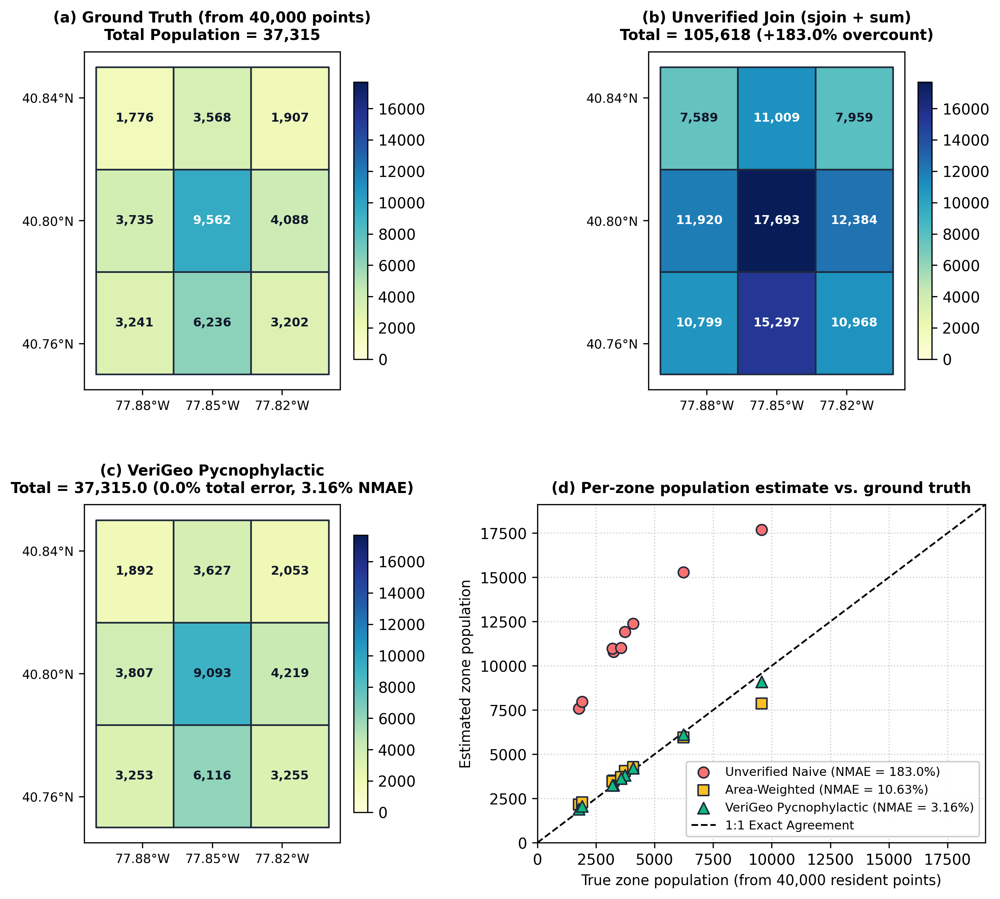

# VeriGeo (`NS-VGP 1.0`): Runtime Verification for Automated GIS

<p align="left">
  
  
  
  
</p>

**VeriGeo (`NS-VGP 1.0`)** is a lightweight Python verification and repair layer for automated GIS scripts and LLM spatial agents.

Libraries like GeoPandas and Shapely allow invalid cartographic, aggregation, topological, and statistical operations without raising Python exceptions. Because of this, scripts written by automated GIS tools frequently exit with code `0` and save an output file while producing wrong maps and tables:

1. **Unprojected Degree Calculations (CRS):** Running Euclidean `buffer`, `area`, `clip`, or `overlay` operations directly on latitude-longitude coordinates (`EPSG:4326`) or fixed `111,320 m/deg` constants, introducing `2.88%–112.63%` geodesic area errors (`35.00%` mean across `12.0°N` to `64.1°N`).
2. **Count Duplication & Ratio Summing in Spatial Joins (MAUP):** Calling `sjoin(...).groupby().sum()` adds every boundary-crossing census tract into every target zone it touches (`+166.05%` average population overcount) while summing ratio columns such as `median_income`, `pop_density`, `ndvi`, or `pm25` (`4.00x` inflation).
3. **Invalid Rings & Overlay Slivers (Topology):** Leaving self-intersecting "bowtie" rings and paper-thin boundary slivers (`Mean Width = 2 * Area / Perimeter < 1.0 m`) in polygon overlay outputs.
4. **Violated Spatial Statistics Assumptions:** Running Moran's $I$, LISA, Getis-Ord $G_i^*$, or GWR on missing values (`NaN`), isolated island polygons with zero touching neighbors under Queen contiguity, small sample sizes ($N < 30$), or redundant collinear predictors (condition number $\kappa > 30$).

**VeriGeo** checks and repairs these four conditions before and after each spatial operation and saves a JSON **Spatial Proof Certificate (`SPC`)** with a SHA-256 hash of the input and output layers.

---

## How VeriGeo Works


| Rule | What VeriGeo Checks | Automatic Repair When Check Fails |
| :--- | :--- | :--- |
| **Rule 1: Map Projections & CRS** | Metric operations (`buffer`, `area`, `spatial_join`, `dissolve`, `intersection`) must use projected coordinates (meters/feet) and matching CRS across layers. | Reprojects geographic (`EPSG:4326`) or mismatched layers to **Equal-Area** (`EPSG:5070` CONUS, `EPSG:3035` Europe, `EPSG:6933` global) for area/aggregation operations or **local UTM** (`EPSG:326xx`/`327xx`) for distance/buffer operations. |
| **Rule 2: Counts vs. Ratios (MAUP)** | Ratio columns (`median_income`, `pop_density`, `rate`, `pct`, `ndvi`, `pm25`) must never be summed (`SUM`), and count columns (`population`, `households`, `crimes`) must conserve total count across zone transfers. | Classifies columns into counts, ratios, and identifiers; runs **Tobler's smooth pycnophylactic interpolation** ($40 \times 40$ grid, 35 smoothing passes with exact tract rescaling) for counts and **area-weighted averaging** for ratios. |
| **Rule 3: Polygon Topology & Slivers** | All input and output polygons must be valid OGC geometries (`is_valid == True`), and overlay outputs must contain no narrow boundary slivers (`2 * Area / Perimeter < 1.0 m`). | Repairs self-intersecting bowtie rings via `shapely.validation.make_valid()` before execution and removes overlay slivers narrower than `1.0 m` in projected meters. |
| **Rule 4: Spatial Statistics Pre-Checks** | Target variable must contain no `NaN`/infinite values and non-zero variance; spatial weight matrix must have zero disconnected islands; GWR predictors must have condition number $\kappa < 30$. | Fills `NaN` values with the median, replaces disconnected Queen/Rook contiguity graphs with row-standardized metric $k$-NN weights, uses `999` permutations when $N < 30$, and drops collinear predictors. |

---

## Benchmark Results ($N=70$ Tasks, $535$ Logged Runs)

Every baseline (`naive`, `naive_pre`, `areaw`), single-rule ablation, and `ns_vgp` run in [`benchmarks/run_experiments.py`](benchmarks/run_experiments.py) runs real GeoPandas, Shapely, and PyProj operations and is scored by an **independent ground-truth evaluator**:

- **CRS Truth (`CRS-01..15`):** Exact WGS84 ellipsoidal geodesic area (`pyproj.Geod(ellps="WGS84").geometry_area_perimeter`) and local Azimuthal Equidistant (`+proj=aeqd`) buffers and clips.
- **MAUP Truth (`MAUP-01..15`):** `40,000` synthetic resident points (`70%` Gaussian hotspots + `30%` background) aggregated into both the $4 \times 4$ source census tracts and the $3 \times 3$ target zones / $4$ dissolved districts.
- **Topology Truth (`TOPO-01..15`):** Minimum rotated bounding rectangle short-side width `< 1.0 m` in `EPSG:32618`.
- **Spatial Statistics Truth (`STAT-01..15`):** Finite output check, zero disconnected islands (`weights_islands == 0`), and standardized predictor matrix condition number $\kappa < 30$.
- **Clean Control Group (`CTRL-01..10`):** Already-projected `EPSG:32618` inputs verifying zero false-positive edits (`repairs == 0`).


| Task Category | Method | Passed ($k/N$) | Pass Rate (%) [95% Wilson CI] | Mean Area Error (%) | Total Pop Error (%) | Zone Pop NMAE (%) / Slivers | Income Ratio ($\times$) / $\kappa$ | Mean Latency ($\text{ms} \pm \text{SD}$) |
| :--- | :--- | :---: | :---: | :---: | :---: | :---: | :---: | :---: |
| **1. CRS Distortion** ($N=15$) | `naive` | `0/15` | `0.0%` `[0.0, 20.4]` | `35.00%` (med `26.87%`) | — | — | — | `58.00 ± 166.33` |
| | `naive_pre` | `0/15` | `0.0%` `[0.0, 20.4]` | `35.00%` (med `26.87%`) | — | — | — | `14.04 ± 8.05` |
| | **VeriGeo (`ns_vgp`)** | **`15/15`** | **`100.0%` `[79.6, 100.0]`** | **`0.023%` (med `0.015%`)** | — | — | — | **`33.34 ± 25.81`** |
| **2. MAUP Aggregation** ($N=15$) | `naive` | `0/15` | `0.0%` `[0.0, 20.4]` | — | `166.05%` (joins) | `166.05%` | `4.001x` | `23.76 ± 13.48` |
| | `naive_pre` | `0/15` | `0.0%` `[0.0, 20.4]` | — | `166.05%` (joins) | `166.05%` | `4.001x` | `19.44 ± 8.51` |
| | `areaw` ($N=10$ joins) | `10/10` | `100.0%` `[72.2, 100.0]` | — | `0.0003%` | `7.92%` | `1.001x` | `73.26 ± 33.90` |
| | **VeriGeo (`ns_vgp`)** | **`15/15`** | **`100.0%` `[79.6, 100.0]`** | — | **`0.0000%` (`1.9e-15%`)** | **`3.62%`** | **`1.001x`** | **`189.46 ± 104.72`** |
| **3. Topology & Slivers** ($N=15$) | `naive` | `0/15` | `0.0%` `[0.0, 20.4]` | — | — | `2.00` slivers | — | `235.47 ± 31.87` |
| | `naive_pre` | `0/15` | `0.0%` `[0.0, 20.4]` | — | — | `2.00` slivers | — | `231.32 ± 24.49` |
| | `ns_vgp_v1` (`pp_relative`) | `10/15` | `66.7%` `[41.7, 84.8]` | — | — | `0.47` slivers | — | `69.02 ± 20.53` |
| | **VeriGeo (`ns_vgp`)** | **`15/15`** | **`100.0%` `[79.6, 100.0]`** | — | — | **`0.00` slivers** | — | **`66.13 ± 11.89`** |
| **4. Spatial Statistics** ($N=15$) | `naive` | `0/15` | `0.0%` `[0.0, 20.4]` | — | — | `2` islands, `NaN` | `κ ≤ 133,728` | `7.71 ± 1.48` |
| | `naive_pre` | `0/15` | `0.0%` `[0.0, 20.4]` | — | — | `2` islands | `κ ≤ 133,728` | `10.65 ± 1.98` |
| | **VeriGeo (`ns_vgp`)** | **`15/15`** | **`100.0%` `[79.6, 100.0]`** | — | — | **`0` islands** | **`κ = 1.00`** | **`20.12 ± 4.50`** |
| **5. Clean Control** ($N=10$) | `naive` | `10/10` | `100.0%` `[72.2, 100.0]` | `0.030%` | — | `0` repairs | — | `5.65 ± 5.04` |
| | `naive_pre` | `10/10` | `100.0%` `[72.2, 100.0]` | `0.030%` | — | `0` repairs | — | `5.65 ± 5.36` |
| | **VeriGeo (`ns_vgp`)** | **`10/10`** | **`100.0%` `[72.2, 100.0]`** | **`0.030%`** | — | **`0` repairs** | — | **`13.55 ± 3.85`** |
| **All Tasks ($N=70$)** | `naive` | `10/70` | `14.3%` `[7.9, 24.3]` | `35.00%` | `166.05%` | `166.05%` | `4.001x` | `70.56` |
| | `naive_pre` | `10/70` | `14.3%` `[7.9, 24.3]` | `35.00%` | `166.05%` | `166.05%` | `4.001x` | `59.97` |
| | **VeriGeo (`ns_vgp`)** | **`70/70`** | **`100.0%` `[94.8, 100.0]`** | **`0.023%`** | **`0.0000%`** | **`3.62%`** | **`1.001x`** | **`68.16`** |

---

## Case Study (`MAUP-01`): 40,000-Point Ground Truth vs. Polygon Interpolation



## Rule-by-Rule Ablation Study & Runtime


---

## Quickstart

### 1. Installation

```bash
git clone https://github.com/sutharprin098/VeriGeo.git
cd VeriGeo
pip install -e .[dev]
```

### 2. Verify & Repair a Spatial Join in Python

```python
import geopandas as gpd
from shapely.geometry import box
from verigeo import NeuroSymbolicGeoVerifier

# Source census tracts (Count column: population | Ratio column: median_income)
tracts = gpd.GeoDataFrame(
    {
        "tract_id": ["T1", "T2", "T3", "T4"],
        "population": [2500.0, 4500.0, 3000.0, 5000.0],
        "median_income": [50000.0, 70000.0, 60000.0, 80000.0],
    },
    geometry=[
        box(-77.90, 40.75, -77.85, 40.80),
        box(-77.85, 40.75, -77.80, 40.80),
        box(-77.90, 40.80, -77.85, 40.85),
        box(-77.85, 40.80, -77.80, 40.85),
    ],
    crs="EPSG:4326",
)

# Shifted target planning zones
zones = gpd.GeoDataFrame(
    {"zone_id": ["Z1", "Z2", "Z3"]},
    geometry=[
        box(-77.90, 40.75, -77.83, 40.82),
        box(-77.83, 40.75, -77.80, 40.82),
        box(-77.90, 40.82, -77.80, 40.85),
    ],
    crs="EPSG:4326",
)

verifier = NeuroSymbolicGeoVerifier(auto_heal=True)
verified_gdf, spc = verifier.verify_and_execute(
    operator="spatial_join",
    primary_gdf=tracts,
    secondary_gdf=zones,
    parameters={"aggfunc": "sum"},  # SUM on median_income is automatically blocked and replaced
)

print("Verifiable Guarantee:", spc.verifiable_guarantee)
print("Conserved Population Total:", verified_gdf["population"].sum())  # Exact: 15000.0
print("Repairs Applied:", spc.repairs_applied)
print("Provenance SHA-256:", spc.provenance_sha256)
```

### 3. Reproduce the 70-Task Benchmark & Figures

```bash
python benchmarks/run_experiments.py
pytest -v
```

---

## Repository Structure

```text
VeriGeo/
├── verigeo/
│   ├── __init__.py          # Public API exports
│   ├── protocol.py          # Core 4-Rule Verifier, Pycnophylactic Solver & SPC Engine
│   ├── middleware.py        # Service Middleware & Merkle-Chained Pipeline Executor
│   └── cli.py               # Command-line interface (`verigeo verify`)
├── benchmarks/
│   ├── run_experiments.py   # 70-task benchmark, independent ground-truth evaluator & figure generator
│   ├── benchmark_results.json
│   └── per_task_validation_log.csv
├── paper/
│   ├── main.tex             # Two-column LaTeX manuscript (EarthArXiv / Overleaf ready)
│   ├── references.bib       # Verified BibTeX bibliography with DOIs
│   ├── MANUSCRIPT.md        # Markdown version of the manuscript
│   ├── VeriGeo_Overleaf_Submission.zip
│   └── figures/             # 300-DPI publication figures (PNG + PDF)
├── tests/
│   └── test_verigeo.py      # Pytest test suite (8 end-to-end tests)
├── pyproject.toml
└── LICENSE
```

---

## Citation

```bibtex
@article{suthar2026verigeo,
  author  = {Suthar, Prince},
  title   = {{VeriGeo}: Runtime Verification for Projections, Areal Interpolation, Topology, and Spatial Statistics in Automated {GIS}},
  journal = {EarthArXiv Preprint},
  year    = {2026},
  url     = {https://github.com/sutharprin098/VeriGeo}
}
```
