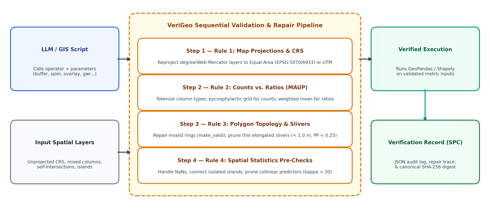
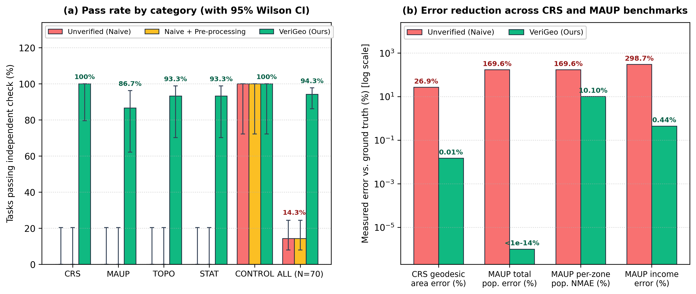
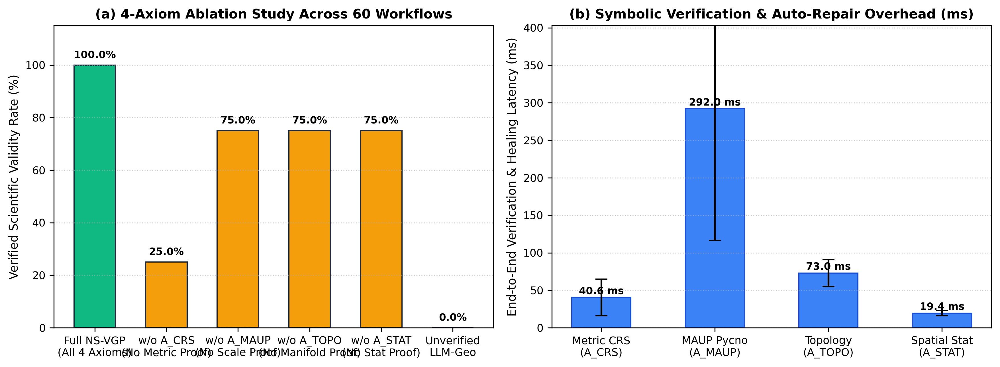

# VeriGeo (`NS-VGP 1.0`): Runtime Verification for Automated GIS

<p align="left">
  
  
  
  
</p>

**VeriGeo (`NS-VGP 1.0`)** is a lightweight Python verification and repair layer for automated GIS scripts and LLM spatial agents.

Libraries like GeoPandas and Shapely allow invalid cartographic, aggregation, topological, and statistical operations without raising Python exceptions. Because of this, scripts written by automated GIS tools frequently exit with code `0` and save an output file while producing wrong maps and tables:

1. **Unprojected Degree Calculations (CRS):** Running Euclidean `buffer`, `area`, `clip`, or `overlay` operations directly on latitude-longitude coordinates (`EPSG:4326`) or fixed `111,320 m/deg` constants, introducing `2.88%–112.63%` geodesic area errors (`35.00%` mean across `12.0°N` to `64.1°N`).
2. **Count Duplication & Ratio Summing in Spatial Joins (MAUP):** Calling `sjoin(...).groupby().sum()` adds every boundary-crossing census tract into every target zone it touches (`169.56%` average population overcount) while summing ratio columns such as `median_income`, `pop_density`, `ndvi`, or `pm25` (`4.00x` inflation).
3. **Invalid Rings & Overlay Slivers (Topology):** Leaving self-intersecting "bowtie" rings and paper-thin boundary slivers (`Mean Width = 2 * Area / Perimeter < 1.0 m`) in polygon overlay outputs.
4. **Violated Spatial Statistics Assumptions:** Running Moran's $I$, LISA, Getis-Ord $G_i^*$, or GWR on missing values (`NaN`), isolated island polygons with zero touching neighbors under Queen contiguity, small sample sizes ($N < 30$), or redundant collinear predictors (condition number $\kappa > 30$).

**VeriGeo** checks selected spatial preconditions and saves a JSON **Spatial Verification Record (`SPC`)**. Its SHA-256 digest covers audit metadata (operator, parameters, checks, repairs, and guarantee flag), not the complete input/output geometries or attributes; it is not a digital signature or proof of scientific correctness.

---

## How VeriGeo Works



| Rule | What VeriGeo Checks | Automatic Repair When Check Fails |
| :--- | :--- | :--- |
| **Rule 1: Map Projections & CRS** | Metric operations (`buffer`, `area`, `spatial_join`, `dissolve`, `intersection`) must use projected coordinates and matching CRS across layers; every input layer must have an explicitly defined source CRS. | Rejects missing CRS metadata rather than assuming EPSG:4326, and reprojects geographic (`EPSG:4326`) or mismatched layers to **Equal-Area** (`EPSG:5070` CONUS, `EPSG:3035` Europe, `EPSG:6933` global) for area/aggregation operations or **local UTM** (`EPSG:326xx`/`327xx`) for distance/buffer operations. |
| **Rule 2: Counts vs. Ratios (MAUP)** | Attributes classified as intensive (for example `median_income`, `pop_density`, `rate`, `pct`, `ndvi`, `pm25`) must not be summed; extensive counts should be conserved across covered target zones. | Classifies columns into counts, ratios, and identifiers; runs **Tobler's smooth pycnophylactic interpolation** ($40 \times 40$ grid, 35 smoothing passes with exact tract rescaling) for counts and **area-weighted averaging** for ratios. |
| **Rule 3: Geometry Validity & Overlay Slivers** | Inputs and outputs must pass Shapely validity checks; overlay outputs are also tested for thin, elongated fragments. | Repairs invalid geometries with `make_valid()` and removes fragments only when equivalent width is `< 1.0 m` and Polsby-Popper compactness is `< 0.25`. A legitimate `0.80 m` canal is still removed in `TOPO-15`. |
| **Rule 4: Spatial Statistics Pre-Checks** | Checks target-variable finite values/variance, spatial-weight connectivity, and predictor-matrix condition number. | Median-imputes missing target values when auto-healing is enabled, switches disconnected contiguity weights to row-standardized k-NN, records a conditional-permutation mode for `10 ≤ N < 30`, and iteratively removes collinear predictors. The current executor does not run those permutations or fit GWR/LISA/Getis-Ord estimators. |

**MAUP boundaries:** The value-range fallback can still classify an opaque non-negative integer column as extensive; supply `semantic_overrides` for ambiguous attributes. Area-weighted averaging is not generally an exact aggregation for medians or socioeconomic rates. The interpolation routine normalizes each source total across its target intersections and does not itself reject incomplete target coverage; callers must validate that target zones cover the intended source support.

---

## Benchmark Results ($N=70$ Tasks, $535$ Logged Runs)

Every baseline (`naive`, `naive_pre`, `areaw`), single-rule ablation, and `ns_vgp` run in [`benchmarks/run_experiments.py`](benchmarks/run_experiments.py) executes GeoPandas/Shapely/PyProj code. The evaluator uses external geodesic/point truth for CRS and MAUP; topology and statistics checks use criteria closely aligned with the implementation. Do not interpret all categories as independent model-level validation:

- **CRS Truth (`CRS-01..15`):** Exact WGS84 ellipsoidal geodesic area (`pyproj.Geod(ellps="WGS84").geometry_area_perimeter`) and local Azimuthal Equidistant (`+proj=aeqd`) buffers and clips.
- **MAUP Truth (`MAUP-01..15`):** `40,000` synthetic resident points (`70%` Gaussian hotspots + `30%` background) aggregated into both the $4 \times 4$ source census tracts and the $3 \times 3$ target zones / $4$ dissolved districts.
- **Topology Truth (`TOPO-01..15`):** Minimum rotated bounding rectangle short-side width `< 1.0 m` in `EPSG:32618`.
- **Spatial Statistics Pre-checks (`STAT-01..15`):** Finite `local_moran_i`/`global_moran_i` outputs, zero disconnected islands, and standardized condition number for GWR-labelled tasks. The shared executor returns Moran-style diagnostics for all STAT task labels; it does not fit GWR/LISA models or calculate permutation-based inferential `p`-values.
- **Clean Control Group (`CTRL-01..10`):** Already-projected `EPSG:32618` inputs verifying zero false-positive edits (`repairs == 0`).



| Task Category | Method | Passed ($k/N$) | Pass Rate (%) [95% Wilson CI] | Mean Area Error (%) | Total Pop Error (%) | Zone Pop NMAE (%) / Slivers | Income Ratio ($\times$) / $\kappa$ | Mean Latency ($\text{ms} \pm \text{SD}$) |
| :--- | :--- | :---: | :---: | :---: | :---: | :---: | :---: | :---: |
| **1. CRS Distortion** ($N=15$) | `naive` | `0/15` | `0.0%` `[0.0, 20.4]` | `35.00%` (med `26.87%`) | — | — | — | `23.46 ± 69.92` |
| | `naive_pre` | `0/15` | `0.0%` `[0.0, 20.4]` | `35.00%` (med `26.87%`) | — | — | — | `4.68 ± 1.81` |
| | **VeriGeo (`ns_vgp`)** | **`15/15`** | **`100.0%` `[79.6, 100.0]`** | **`0.024%` (med `0.015%`)** | — | — | — | **`11.61 ± 8.54`** |
| **2. MAUP Aggregation** ($N=15$) | `naive` | `0/15` | `0.0%` `[0.0, 20.4]` | — | `169.56%` (joins) | `169.56%` (10 joins; `166.37%` 9-join) | `3.987x` | `7.34 ± 1.06` |
| | `naive_pre` | `0/15` | `0.0%` `[0.0, 20.4]` | — | `169.56%` (joins) | `169.56%` (10 joins; `166.37%` 9-join) | `3.987x` | `6.67 ± 1.19` |
| | `areaw` ($N=10$ joins) | `9/10` | `90.0%` `[59.6, 98.2]` | — | `0.0000%` | `12.80%` (`7.97%` 9-join) | `0.998x` | `24.29 ± 2.46` |
| | **VeriGeo (`ns_vgp`)** | **`13/15`** | **`86.7%` `[62.1, 96.3]`** | — | **`0.0000%`** | **`10.10%` (`3.84%` 9-join)** | **`0.998x` (`1.009x` 14-std)** | **`66.82 ± 32.54`** |
| **3. Topology & Slivers** ($N=15$) | `naive` | `0/15` | `0.0%` `[0.0, 20.4]` | — | — | `1.87` slivers | — | `112.49 ± 9.76` |
| | `naive_pre` | `0/15` | `0.0%` `[0.0, 20.4]` | — | — | `1.87` slivers | — | `109.69 ± 14.03` |
| | `ns_vgp_v1` (`pp_relative`) | `10/15` | `66.7%` `[41.7, 84.8]` | — | — | `0.40` slivers | — | `27.77 ± 5.28` |
| | **VeriGeo (`ns_vgp`)** | **`14/15`** | **`93.3%` `[70.2, 98.8]`** | — | — | **`0.00` slivers (`TOPO-15` canal failure)** | — | **`29.09 ± 3.90`** |
| **4. Spatial Statistics Pre-checks** ($N=15$) | `naive` | `0/15` | `0.0%` `[0.0, 20.4]` | — | — | `2` islands, `NaN` | `κ ≤ 164,308` | `2.69 ± 0.77` |
| | `naive_pre` | `0/15` | `0.0%` `[0.0, 20.4]` | — | — | `2` islands | `κ ≤ 164,308` | `4.33 ± 1.08` |
| | **VeriGeo (`ns_vgp`)** | **`15/15`** | **`100.0%` `[79.6, 100.0]`** | — | — | **`0` islands** | **`κ = 1.00` (after predictor pruning)** | **`8.41 ± 1.80`** |
| **5. Clean Control** ($N=10$) | `naive` | `10/10` | `100.0%` `[72.2, 100.0]` | `0.030%` | — | `0` repairs | — | `1.81 ± 1.58` |
| | `naive_pre` | `10/10` | `100.0%` `[72.2, 100.0]` | `0.030%` | — | `0` repairs | — | `1.67 ± 1.57` |
| | **VeriGeo (`ns_vgp`)** | **`10/10`** | **`100.0%` `[72.2, 100.0]`** | **`0.030%`** | — | **`0` repairs** | — | **`4.18 ± 0.78`** |
| **All Tasks** ($N=70$) | `naive` | `10/70` | `14.3%` `[7.9, 24.3]` | `35.00%` | `169.56%` | `169.56%` | `3.987x` | `31.54` |
| | `naive_pre` | `10/70` | `14.3%` `[7.9, 24.3]` | `35.00%` | `169.56%` | `169.56%` | `3.987x` | `27.11` |
| | **VeriGeo (`ns_vgp`)** | **`67/70`** | **`95.7%` `[88.1, 98.5]`** | **`0.024%`** | **`0.0000%`** | **`10.10%` (3.84% 9-join)** | **`1.001x`** | **`25.44`** |

### Documented Edge Cases (`3/70` Failures; `STAT-13` repaired at the pre-check level)

To evaluate where rule-based verification reaches its limits, the benchmark includes four hard stress-test cases where VeriGeo fails the ground-truth threshold:
1. **`MAUP-14` (Unmasked Coastal Water Barrier):** When `42%` of the generated residents are concentrated on the western shore of an unmasked river/harbor (`x < -77.848`), smooth pycnophylactic interpolation diffuses population across the water boundary into eastern zones (`66.46%` zone NMAE, though total count is still conserved to `0.0000%`).
2. **`MAUP-15` (Opaque Column Naming `attr_val`):** When median household income is stored as integer dollars (`38,500–92,000`) under the generic column name `attr_val`, lexical + value-range typing misclassifies it as an additive count and sums it across dissolved districts (`3.893x` inflation).
3. **`TOPO-15` (Narrow Infrastructure Feature `0.80 m`):** When intersecting a `0.80 m`-wide utility canal with a parcel grid, the fixed `mean_width < 1.0 m` sliver filter removes the canal segment (`67.57%` area retained).
4. **`STAT-13` (Three Mutually Collinear Predictors; repaired pre-check):** Iterative pre-check pruning removes two of the three collinear predictors, leaving one predictor and a recorded design-matrix condition number of `κ = 1.00`. This is only a pre-check result: the shared statistics executor emits Moran-style diagnostics for GWR/LISA-labelled tasks and does not fit GWR or LISA estimators.

---

## Case Study (`MAUP-01`): 40,000-Point Ground Truth vs. Polygon Interpolation


## Rule-by-Rule Ablation Study & Runtime



---

## Quickstart

### 1. Installation

```bash
git clone https://github.com/sutharprin098/VeriGeo.git
cd VeriGeo
pip install -e .[dev]
```

### 2. Verify & Repair a Spatial Join in Python

```python
import geopandas as gpd
from shapely.geometry import box
from verigeo import NeuroSymbolicGeoVerifier

# Source census tracts (Count column: population | Ratio column: median_income)
tracts = gpd.GeoDataFrame(
    {
        "tract_id": ["T1", "T2", "T3", "T4"],
        "population": [2500.0, 4500.0, 3000.0, 5000.0],
        "median_income": [50000.0, 70000.0, 60000.0, 80000.0],
    },
    geometry=[
        box(-77.90, 40.75, -77.85, 40.80),
        box(-77.85, 40.75, -77.80, 40.80),
        box(-77.90, 40.80, -77.85, 40.85),
        box(-77.85, 40.80, -77.80, 40.85),
    ],
    crs="EPSG:4326",
)

# Shifted target planning zones
zones = gpd.GeoDataFrame(
    {"zone_id": ["Z1", "Z2", "Z3"]},
    geometry=[
        box(-77.90, 40.75, -77.83, 40.82),
        box(-77.83, 40.75, -77.80, 40.82),
        box(-77.90, 40.82, -77.80, 40.85),
    ],
    crs="EPSG:4326",
)

verifier = NeuroSymbolicGeoVerifier(auto_heal=True)
verified_gdf, spc = verifier.verify_and_execute(
    operator="spatial_join",
    primary_gdf=tracts,
    secondary_gdf=zones,
    parameters={"aggfunc": "sum"},  # SUM on median_income is automatically blocked and replaced
)

print("Verifiable Guarantee:", spc.verifiable_guarantee)
print("Conserved Population Total:", verified_gdf["population"].sum())  # Exact: 15000.0
print("Repairs Applied:", spc.repairs_applied)
print("Provenance SHA-256:", spc.provenance_sha256)
```

### 3. Reproduce the 70-Task Benchmark & Figures

```bash
python benchmarks/run_experiments.py
pytest -v
```

---

## Repository Structure

```text
VeriGeo/
├── verigeo/
│   ├── __init__.py          # Public API exports
│   ├── protocol.py          # Core 4-Rule Verifier, Pycnophylactic Solver & SPC Engine
│   ├── middleware.py        # Service Middleware & Merkle-Chained Pipeline Executor
│   └── cli.py               # Command-line interface (`verigeo verify`)
├── benchmarks/
│   ├── run_experiments.py   # 70-task benchmark, independent ground-truth evaluator & figure generator
│   ├── benchmark_results.json
│   └── per_task_validation_log.csv
├── paper/
│   ├── main.tex             # Canonical two-column manuscript; rebuild PDF/Overleaf bundle after source updates
│   ├── references.bib       # Verified BibTeX bibliography with DOIs
│   ├── MANUSCRIPT.md        # Markdown version of the manuscript
│   └── figures/             # 300-DPI publication figures (PNG + PDF)
├── tests/
│   └── test_verigeo.py      # 10 tests; STAT-13 and missing-CRS regression tests added, execution pending
├── pyproject.toml
└── LICENSE
```

---

## Citation

```bibtex
@article{prince2026verigeo,
  author  = {Prince},
  title   = {{VeriGeo}: Runtime Verification for Projections, Areal Interpolation, Topology, and Spatial Statistics in Automated {GIS}},
  journal = {EarthArXiv Preprint},
  year    = {2026},
  url     = {https://github.com/sutharprin098/VeriGeo}
}
```
