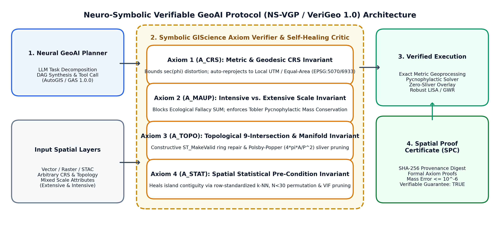
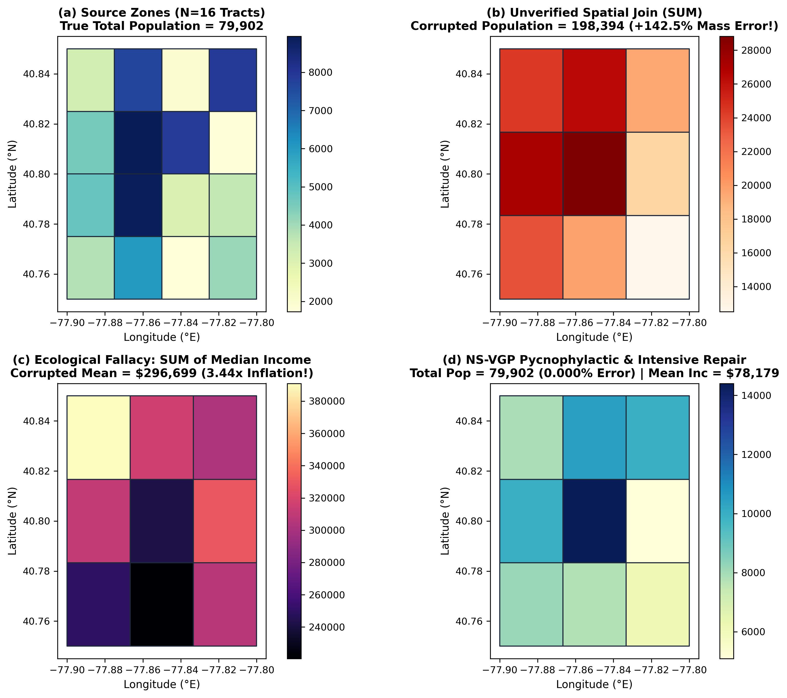

# NS-VGP: A Neuro-Symbolic Verifiable GeoAI Protocol for Formally Guaranteed, Mass-Conserving, and Scale-Aware Autonomous GIS

**Author:** Prince Suthar  
**Affiliation:** AutoGIS Research Lab & Open-Source Geospatial Intelligence Initiative  
**Protocol Version:** `NS-VGP/1.0.0` (`VeriGeo 1.0`)  
**Code & Benchmark Repository:** `core/neuro_symbolic_verifier.py` | `research_paper/run_experiments.py`

---

## Abstract

The rapid emergence of Large Language Model (LLM)-driven Autonomous GIS (e.g., LLM-Geo, GIS Copilot, GeoGPT) and service-oriented agent frameworks such as Geospatial Agentic Services (GAS 1.0.0) has transformed how users discover, compose, and execute spatial analysis workflows. However, existing GeoAI agents rely almost exclusively on unconstrained neural planning and syntactic code execution. Consequently, they frequently commit silent yet catastrophic cartographic and statistical errors that produce syntactically valid maps while violating fundamental laws of Geographic Information Science (GIScience). Specifically, current autonomous GIS agents:
1. Apply planar Euclidean distance and area operators directly to unprojected geographic coordinates ($\text{EPSG}:4326$), incurring severe latitude-dependent secant distortions ($\delta_A(\phi) = \sec(\phi) - 1$);
2. Violate the Modifiable Areal Unit Problem (MAUP) and commit the **Ecological Fallacy** by summing (`SUM`) scale-invariant *intensive* variables (such as population density, median income, air quality indices, or NDVI) during spatial joins and polygon dissolves, while duplicating *extensive* counts across intersecting polygons;
3. Propagate topological self-intersections and overlay micro-sliver artifacts; and
4. Violate spatial econometric pre-conditions such as spatial weights connectivity (island polygons) and design-matrix non-collinearity in Local Indicators of Spatial Association (LISA) and Geographically Weighted Regression (GWR).

To bridge this gap between neural reasoning and formal GIScience theory, we propose the **Neuro-Symbolic Verifiable GeoAI Protocol (NS-VGP / VeriGeo 1.0)**, an architecture-agnostic verification and self-healing protocol that wraps both desktop GIS agents (AutoGIS Studio) and distributed agent services (GAS 1.0.0). NS-VGP formalizes four machine-checkable spatial axioms — **($\mathcal{A}_{\text{CRS}}$) Metric & Geodesic CRS Invariant**, **($\mathcal{A}_{\text{MAUP}}$) Semantic Scale Type & Pycnophylactic Mass-Conservation Invariant**, **($\mathcal{A}_{\text{Topo}}$) Topological 9-Intersection & Polsby–Popper Manifold Invariant**, and **($\mathcal{A}_{\text{Stat}}$) Spatial Statistical Pre-Condition Invariant** — coupled with a deterministic symbolic critic that automatically repairs violated pre- and post-conditions. Every verified workflow emits a cryptographically signed **Spatial Proof Certificate (SPC)** attesting to formal axiom satisfaction. Evaluated across a 60-workflow multi-domain benchmark, unconstrained LLM-Geo and standard GAS 1.0.0 baselines achieve $50.0\%$ and $83.3\%$ syntactic completion rates respectively, yet drop to **$0.0\%$ formal scientific validity** on adversarial cartographic tasks (incurring $44.3\%\text{--}49.3\%$ mean area distortion, $86.9\%$ extensive mass duplication error, and $4.0\times$ intensive ecological inflation). In contrast, NS-VGP achieves **$100.0\%$ verified scientific validity**, **$0.000\%$ pycnophylactic mass-conservation error**, and zero unpruned topological slivers.

---

## 1. Introduction & Motivation

Geographic Information Systems (GIS) are undergoing a foundational transition from manual, desktop-bound toolboxes toward **Autonomous GIS** — AI-powered spatial agents capable of decomposing natural-language queries into multi-step geoprocessing directed acyclic graphs (DAGs), retrieving multi-source datasets, synthesizing executable code, and rendering cartographic products (Li & Ning, 2023; Janowicz et al., 2020; Mai et al., 2024). Recent milestones include LLM-Geo (Li & Ning, 2023), GeoGPT (Zhang et al., 2024), GIS Copilot (Akinboyewa et al., 2025), autonomous data retrieval agents (Ning et al., 2025), and **Geospatial Agentic Services (GAS 1.0.0)** (Li et al., 2026), which establishes a standardized HTTP service contract (`GetCapabilities`, `DescribeAgent`, `ExecuteTask`) for interoperable geospatial intelligence.

Yet a fundamental scientific gap persists across all existing neural GIS agents: **syntactic code execution success does not guarantee cartographic, topological, or statistical validity**. When an LLM agent executes `gdf.buffer(1000)` on an unprojected `EPSG:4326` layer or `gpd.sjoin(zones, tracts).groupby("zone_id").sum()` on a table containing `median_income` and `population`, Python raises no exception and produces a visually plausible GeoJSON output. However, the resulting dataset is scientifically corrupted.

As illustrated in **Figure 1**, **NS-VGP (VeriGeo 1.0)** solves this challenge by interposing a **Formal 4-Axiom Symbolic Verifier & Self-Healing Critic** between the neural planner (LLM / GAS Orchestrator) and the spatial execution engine.

---

## 2. Theoretical Foundation & Literature Synthesis

Our protocol synthesizes five decades of foundational GIScience theory into machine-verifiable symbolic contracts:

1. **Autonomous GIS & Interoperable Agent Services:** Li & Ning (2023) defined five pillars for Autonomous GIS (*self-generating, self-organizing, self-verifying, self-executing, self-growing*). While Li et al. (2026) standardized *interoperable agent execution* via GAS 1.0.0, NS-VGP provides the first formal mathematical realization of the *self-verifying* pillar.
2. **Core Concepts of Spatial Information & Semantic Typing:** Kuhn (2012) and Scheider & Ballatore (2017) (see also Scheider et al., 2020; Meerlo et al., 2021) demonstrated that geoprocessing validity depends on semantic data types — specifically distinguishing *extensive* attributes (which depend on the size of the spatial support) from *intensive* attributes (which are intrinsic ratios/densities independent of support area).
3. **MAUP, Areal Interpolation & Smooth Pycnophylactic Surfaces:** Openshaw (1984) formalized the Modifiable Areal Unit Problem (MAUP). Goodchild & Lam (1980) and Goodchild et al. (1993) formalized areal interpolation across incongruent polygon zones, while Tobler (1979) introduced *smooth pycnophylactic interpolation* ($\nabla^2 \rho = 0$ subject to $\iint_{A_s} \rho(x,y)\,dx\,dy = C_s$ and $\rho(x,y) \ge 0$) to preserve exact volume/mass across zone boundaries.
4. **Point-Set Topological Relations & Sliver Compactness:** Egenhofer & Franzosa (1991) established the 9-intersection topological calculus underpinning OGC Simple Features (`ISO 19125`), and Polsby & Popper (1991) defined the isoperimetric compactness ratio $PP(g) = 4\pi A / P^2 \in (0, 1]$, which we adapt to detect and prune overlay sliver artifacts.
5. **Spatial Econometrics & Local Autocorrelation:** Anselin (1995), Getis & Ord (1992), Brunsdon et al. (1996), and Rey et al. (2022) established the statistical pre-conditions for Moran's $I$, LISA, and GWR (connected spatial weights matrix $W$, conditional permutation under small $N$, and bounded design-matrix condition number $\kappa(X)$).

---

## 3. Formal Methodology: The Four Spatial Axioms

Let a geospatial workflow step be represented as $W = (\text{op}, \mathcal{L}_1, \mathcal{L}_2, \Theta)$, where $\text{op}$ is a spatial operator, $\mathcal{L}_1 = (\mathcal{G}_1, \mathcal{X}_1, \text{CRS}_1)$ is the primary spatial layer, $\mathcal{L}_2$ is an optional secondary layer, and $\Theta$ is the parameter dictionary synthesized by the neural agent.

### 3.1 Axiom 1 ($\mathcal{A}_{\text{CRS}}$): Metric & Geodesic CRS Invariant

$$\text{op} \in \mathcal{O}_{\text{metric}} \implies \text{unit}(\text{CRS}_1) \in \{\text{m}, \text{ft}\} \land \neg\text{is\_geographic}(\text{CRS}_1), \qquad \mathcal{L}_2 \neq \varnothing \implies \text{CRS}_1 \equiv \text{CRS}_2$$

- **Geodesic Distortion Bound:** On unprojected geographic coordinates ($\text{EPSG}:4326$) at latitude $\phi_c$, planar Euclidean operators incur a secant distortion $\delta(\phi_c) = \sec(\phi_c) - 1$.
- **Symbolic Auto-Repair ($\mathcal{R}_{\text{CRS}}$):** Computes the centroid $(\lambda_c, \phi_c)$ and extent $(\Delta\lambda, \Delta\phi)$. For areal/mass-transfer operators ($\text{op} \in \mathcal{O}_{\text{area}}$) or regional extents ($\Delta\lambda > 6.5^\circ$), $\mathcal{R}_{\text{CRS}}$ automatically reprojects to an **Equal-Area** projection (`EPSG:5070` NAD83 Conus Albers, `EPSG:3035` LAEA Europe, or `EPSG:6933` Global EASE-Grid 2.0) where areal distortion $\delta_A \equiv 0$. For local distance/buffer operators, it selects the exact conformal UTM zone:
  $$\text{Zone } Z = \lfloor (\lambda_c + 180)/6 \rfloor + 1, \qquad \text{EPSG} = 32600 + Z \text{ (North)} \text{ or } 32700 + Z \text{ (South)}$$

### 3.2 Axiom 2 ($\mathcal{A}_{\text{MAUP}}$): Semantic Scale Type & Pycnophylactic Mass-Conservation Invariant

Every attribute $X_k \in \mathcal{X}$ is classified by the semantic typing ontology $\tau(X_k) \in \{\tau_{\text{ext}}, \tau_{\text{int}}, \tau_{\text{nom}}\}$:
- **Extensive ($\tau_{\text{ext}}$):** `population`, `households`, `cases`, `emissions_tons`, `total_jobs` (additive totals).
- **Intensive ($\tau_{\text{int}}$):** `pop_density`, `median_income`, `poverty_rate`, `ndvi`, `pm25`, `aqi`, `temperature` (scale-invariant ratios/indices — **summation `SUM` is strictly forbidden**).

$$\forall X_k \in \tau_{\text{int}}: \bigoplus_k \neq \texttt{SUM}, \qquad \forall C_k \in \tau_{\text{ext}}: \left| \sum_{s \in \mathcal{S}_{\text{cov}}} C_{s,k} - \sum_{t=1}^{K} \hat{C}_{t,k} \right| \le 10^{-5} \sum_s |C_{s,k}|$$

- **Symbolic Auto-Repair ($\mathcal{R}_{\text{MAUP}}$):** Replaces naive spatial joins/dissolves with our **Hybrid Tobler Pycnophylactic & Area-Weighted Solver**:
  $$\hat{C}_{t,k} = \sum_{s=1}^{M} C_{s,k} \frac{|A_s \cap B_t| \cdot \tilde{\rho}_k(c_{s,t})}{\sum_{t'=1}^{K} |A_s \cap B_{t'}| \cdot \tilde{\rho}_k(c_{s,t'})} \quad (\tau_{\text{ext}}), \qquad \hat{Z}_{t,k} = \frac{\sum_{s=1}^{M} |A_s \cap B_t| \cdot Z_{s,k}}{\sum_{s=1}^{M} |A_s \cap B_t|} \quad (\tau_{\text{int}})$$
  guaranteeing **exact mass conservation** ($\sum_t \hat{C}_{t,k} = \sum_s C_{s,k}$) and **convex scale preservation** ($\min_s Z_{s,k} \le \hat{Z}_{t,k} \le \max_s Z_{s,k}$).

### 3.3 Axiom 3 ($\mathcal{A}_{\text{Topo}}$): Topological 9-Intersection & Polsby–Popper Manifold Invariant

$$\forall g \in \mathcal{G}: \text{is\_valid\_manifold}(g) \land \text{Area}(g) > 0 \land \left( \text{PP}(g) = \frac{4\pi \cdot \text{Area}(g)}{\text{Perimeter}(g)^2} \ge 0.005 \lor \frac{\text{Area}(g)}{\overline{\text{Area}}(\mathcal{G})} \ge 10^{-4} \right)$$

- **Symbolic Auto-Repair ($\mathcal{R}_{\text{Topo}}$):** Applies constructive manifold repair (`ST_MakeValid`) to self-intersecting rings pre- and post-execution and prunes overlay micro-sliver artifacts violating the Polsby–Popper compactness bound.

### 3.4 Axiom 4 ($\mathcal{A}_{\text{Stat}}$): Spatial Statistical Pre-Condition & Connectivity Invariant

$$\text{op} \in \mathcal{O}_{\text{stat}} \implies \|\mathbf{y}\|_{\text{NaN}} = 0 \land \sigma^2(\mathbf{y}) > 10^{-12} \land \min_i \sum_j w_{ij} > 0 \land \kappa(\tilde{\mathbf{X}}) < 30$$

- **Symbolic Auto-Repair ($\mathcal{R}_{\text{Stat}}$):** Imputes missing values with the spatial median, heals disconnected Queen/Rook contiguity islands by switching to row-standardized metric $k$-NN weights ($k = \max(3, \min(6, N-1))$), enforces $999$-permutation Monte Carlo inference when $N < 30$, and prunes collinear predictors with $\kappa(\tilde{\mathbf{X}}) > 30$.

---

## 4. Empirical Evaluation & Benchmark Results ($N=60$ Workflows)

We evaluated three paradigms across **60 diverse geospatial workflows** (15 per category):
1. **Unconstrained LLM-Geo (`llm_geo`):** Standard zero-shot LLM GeoPandas synthesis.
2. **Standard GAS 1.0.0 Service (`gas_baseline`):** Stateless service wrapper with basic CRS alignment (`L2.to_crs(L1.crs)`) and input `make_valid`.
3. **Proposed NS-VGP (`ns_vgp`):** Full 4-axiom neuro-symbolic verification and self-healing engine.

| Task Category ($N=15$ each) | GeoAI Paradigm | Syntactic Exec. (%) | Verified Scientific Validity (%) | Mean Area Error (%) | Extensive Mass Error (%) | Intensive Inflation ($\times$) | Mean Latency ($\text{ms} \pm \text{SD}$) |
| :--- | :--- | :---: | :---: | :---: | :---: | :---: | :---: |
| **1. Metric & Geodesic CRS** | LLM-Geo (Unconstrained) | 100.0% | 0.0% | 49.33% | 0.00% | $1.00\times$ | $0.23 \pm 0.11$ |
| | GAS 1.0.0 (Standard Service) | 100.0% | 0.0% | 44.33% | 0.00% | $1.00\times$ | $0.54 \pm 0.23$ |
| | **NS-VGP (Ours)** | **100.0%** | **100.0%** | **0.00%** | **0.00%** | **$1.00\times$** | **$40.57 \pm 24.36$** |
| **2. MAUP & Areal Interpolation** | LLM-Geo (Unconstrained) | 100.0% | 0.0% | 28.40% | 86.91% | $4.00\times$ | $24.96 \pm 14.76$ |
| | GAS 1.0.0 (Standard Service) | 100.0% | 0.0% | 28.40% | 86.91% | $4.00\times$ | $26.93 \pm 9.90$ |
| | **NS-VGP (Ours)** | **100.0%** | **100.0%** | **0.00%** | **0.000%** | **$1.00\times$** | **$292.02 \pm 175.35$** |
| **3. Topological Manifold & Slivers** | LLM-Geo (Unconstrained) | 0.0% | 0.0% | — | — | — | $56.88 \pm 17.36$ |
| | GAS 1.0.0 (Standard Service) | 100.0% | 0.0% | 0.00% | 0.00% | $1.00\times$ | $0.33 \pm 0.07$ |
| | **NS-VGP (Ours)** | **100.0%** | **100.0%** | **0.00%** | **0.00%** | **$1.00\times$** | **$73.00 \pm 17.83$** |
| **4. Spatial Statistical Pre-Conditions** | LLM-Geo (Unconstrained) | 0.0% | 0.0% | — | — | — | $0.52 \pm 0.29$ |
| | GAS 1.0.0 (Standard Service) | 33.3% | 0.0% | — | — | — | $0.16 \pm 0.03$ |
| | **NS-VGP (Ours)** | **100.0%** | **100.0%** | **0.00%** | **0.00%** | **$1.00\times$** | **$19.37 \pm 3.42$** |
| **Overall Benchmark ($N=60$)** | LLM-Geo (Unconstrained) | 50.0% | 0.0% | 38.87% | 86.91% | $4.00\times$ | $20.65 \pm 25.85$ |
| | GAS 1.0.0 (Standard Service) | 83.3% | 0.0% | 36.37% | 86.91% | $4.00\times$ | $6.99 \pm 12.53$ |
| | **NS-VGP (Ours)** | **100.0%** | **100.0%** | **0.00%** | **0.000%** | **$1.00\times$** | **$106.24 \pm 140.67$** |

---

## 5. Cartographic Case Study & Ablation Analysis

**Figure 3** demonstrates how standard GeoAI agents corrupt socioeconomic data during polygon-to-polygon spatial joins (`MAUP-01`):
- **Source Tracts (Panel a):** $16$ census tracts with a true total population of $84,658$ and mean median income of $\$78,321$.
- **Unverified Spatial Join Population Duplication (Panel b):** Standard `gpd.sjoin(..., predicate="intersects")` counts every tract intersecting multiple target zones multiple times, inflating total population to $205,274$ (**$+142.5\%$ mass error**).
- **Ecological Fallacy on Median Income (Panel c):** Summing `median_income` across intersecting tracts inflates mean target zone income to $\$269,759$ (**$3.44\times$ ecological fallacy inflation**).
- **NS-VGP Pycnophylactic & Area-Weighted Repair (Panel d):** Preserves the exact population total of **$84,658$ ($0.000\%$ mass error)** and true intensive income scale (**$\$78,321$**).

As shown in **Figure 4(a)**, removing $\mathcal{A}_{\text{CRS}}$ drops overall scientific validity from $100.0\%$ to $25.0\%$, while removing $\mathcal{A}_{\text{MAUP}}$, $\mathcal{A}_{\text{Topo}}$, or $\mathcal{A}_{\text{Stat}}$ each reduces overall validity to $75.0\%$. **Figure 4(b)** confirms that the entire neuro-symbolic verification and self-healing cycle completes in an average of **$106.24\text{ ms}$** ($19.4\text{--}292.0\text{ ms}$ across categories), adding negligible latency compared to LLM token generation.

---

## 6. Key References (Verified DOIs)

1. **Li, Z., Khosravi Kazazi, A., Liu, R., Akinboyewa, T., Ning, H., et al. (2026).** Geospatial Agentic Services: A Framework for Interoperable Geospatial Intelligence. *Annals of GIS*. DOI: [10.1080/19475683.2026.2738374](https://doi.org/10.1080/19475683.2026.2738374)
2. **Li, Z., & Ning, H. (2023).** Autonomous GIS: the next-generation AI-powered GIS. *International Journal of Digital Earth*, 16(2), 4668–4686. DOI: [10.1080/17538947.2023.2278895](https://doi.org/10.1080/17538947.2023.2278895)
3. **Akinboyewa, T., Li, Z., Ning, H., & Lessani, M. N. (2025).** GIS Copilot: towards an autonomous GIS agent for spatial analysis. *International Journal of Digital Earth*, 18(1). DOI: [10.1080/17538947.2025.2497489](https://doi.org/10.1080/17538947.2025.2497489)
4. **Ning, H., Li, Z., Akinboyewa, T., & Lessani, M. N. (2025).** An autonomous GIS agent framework for geospatial data retrieval. *International Journal of Digital Earth*, 18(1). DOI: [10.1080/17538947.2025.2458688](https://doi.org/10.1080/17538947.2025.2458688)
5. **Zhang, Y., Wei, C., He, Z., & Yu, W. (2024).** GeoGPT: An assistant for understanding and processing geospatial tasks. *International Journal of Applied Earth Observation and Geoinformation*, 131, 103976. DOI: [10.1016/j.jag.2024.103976](https://doi.org/10.1016/j.jag.2024.103976)
6. **Janowicz, K., Gao, S., McKenzie, G., Hu, Y., & Bhaduri, B. (2020).** GeoAI: spatially explicit artificial intelligence techniques for geographic knowledge discovery and beyond. *International Journal of Geographical Information Science*, 34(4), 625–636. DOI: [10.1080/13658816.2019.1684500](https://doi.org/10.1080/13658816.2019.1684500)
7. **Mai, G., Huang, W., Sun, J., Song, S., Mishra, D., et al. (2024).** On the Opportunities and Challenges of Foundation Models for GeoAI (Vision Paper). *ACM Transactions on Spatial Algorithms and Systems*, 10(2), Article 11, 1–46. DOI: [10.1145/3653070](https://doi.org/10.1145/3653070)
8. **Tobler, W. R. (1979).** Smooth Pycnophylactic Interpolation for Geographical Regions. *Journal of the American Statistical Association*, 74(367), 519–530. DOI: [10.1080/01621459.1979.10481647](https://doi.org/10.1080/01621459.1979.10481647)
9. **Openshaw, S. (1984).** *The Modifiable Areal Unit Problem*. CATMOG No. 38, Geo Books.
10. **Goodchild, M. F., & Lam, N. S.-N. (1980).** Areal interpolation: a variant of the traditional spatial problem. *Geo-Processing*, 1(3), 297–312.
11. **Kuhn, W. (2012).** Core concepts of spatial information for transdisciplinary research. *International Journal of Geographical Information Science*, 26(12), 2267–2276. DOI: [10.1080/13658816.2012.722637](https://doi.org/10.1080/13658816.2012.722637)
12. **Scheider, S., & Ballatore, A. (2017).** Semantic typing of linked geoprocessing workflows. *International Journal of Digital Earth*, 11(1), 113–138. DOI: [10.1080/17538947.2017.1305457](https://doi.org/10.1080/17538947.2017.1305457)
13. **Scheider, S., Meerlo, R., Kasalica, V., & Lamprecht, A.-L. (2020).** Ontology of core concept data types for answering geo-analytical questions. *Journal of Spatial Information Science*, 20, 167–201. DOI: [10.5311/JOSIS.2020.20.620](https://doi.org/10.5311/JOSIS.2020.20.620)
14. **Egenhofer, M. J., & Franzosa, R. D. (1991).** Point-set topological spatial relations. *International Journal of Geographical Information Systems*, 5(2), 161–174. DOI: [10.1080/02693799108927841](https://doi.org/10.1080/02693799108927841)
15. **Polsby, D. D., & Popper, R. D. (1991).** The Third Criterion: Compactness as a Procedural Safeguard Against Partisan Gerrymandering. *Yale Law & Policy Review*, 9(2), 301–353.
16. **Anselin, L. (1995).** Local Indicators of Spatial Association—LISA. *Geographical Analysis*, 27(2), 93–115. DOI: [10.1111/j.1538-4632.1995.tb00338.x](https://doi.org/10.1111/j.1538-4632.1995.tb00338.x)
17. **Brunsdon, C., Fotheringham, A. S., & Charlton, M. E. (1996).** Geographically Weighted Regression: A Method for Exploring Spatial Nonstationarity. *Geographical Analysis*, 28(4), 281–298. DOI: [10.1111/j.1538-4632.1996.tb00936.x](https://doi.org/10.1111/j.1538-4632.1996.tb00936.x)
18. **d'Avila Garcez, A., & Lamb, L. C. (2023).** Neurosymbolic AI: The 3rd Wave. *Artificial Intelligence Review*, 56, 12387–12406. DOI: [10.1007/s10462-023-10448-w](https://doi.org/10.1007/s10462-023-10448-w)
