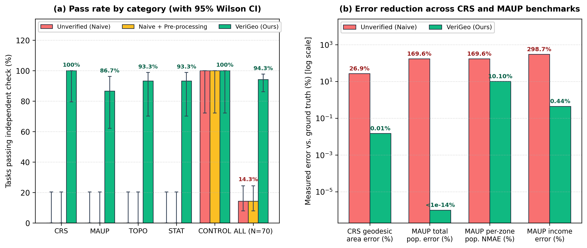
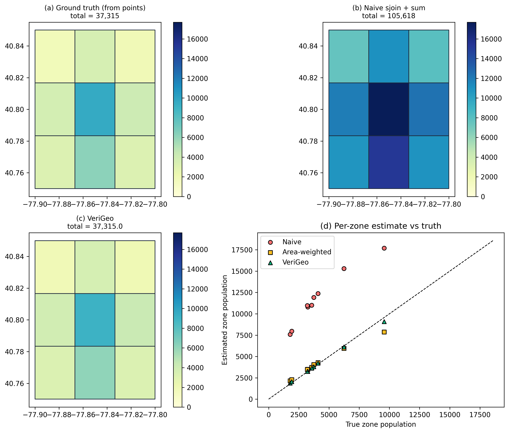
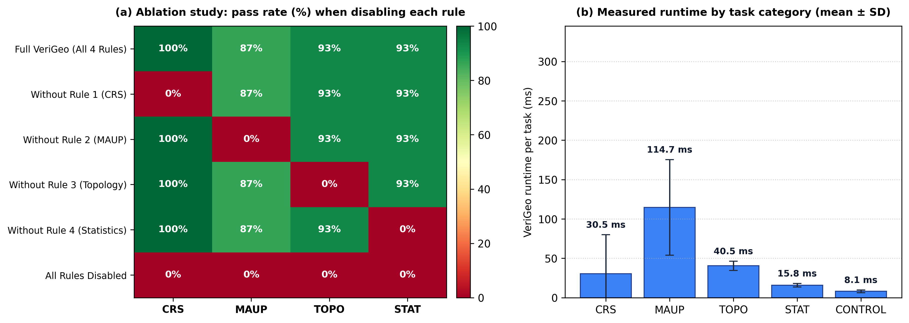

**EarthArXiv Preprint · Non-peer-reviewed preprint submitted to EarthArXiv**

# VeriGeo: Runtime Verification for Projections, Areal Interpolation, Topology, and Spatial Statistics in Automated GIS

**Prince Suthar**  
*AutoGIS Research Lab*  
`https://autogis.princesite.in/` · `https://github.com/sutharprin098/VeriGeo`  
*November 2026*

---

## Abstract

Automated GIS tools use large language models to write and run Python scripts for spatial analysis, treating any script that exits with code `0` as successful. Because GeoPandas and Shapely allow invalid cartographic and statistical operations without raising exceptions, scripts that finish cleanly still frequently produce wrong results: buffers and areas are computed on unprojected latitude-longitude degrees (`EPSG:4326`), spatial joins double-count populations across zone boundaries while summing ratio columns such as median income, polygon overlays leave narrow boundary slivers, and spatial regressions run on disconnected contiguity graphs or collinear predictors. We present **VeriGeo (NS-VGP 1.0)**, a runtime verification layer in Python that checks and repairs four conditions around each spatial operation: metric and equal-area projections, count versus ratio handling via Tobler's pycnophylactic interpolation and area-weighted averaging, polygon ring validity and sliver removal ($2 \times \text{Area}/\text{Perimeter} < 1.0\text{ m}$), and spatial regression pre-checks. Each run outputs a JSON **Spatial Proof Certificate (SPC)** with a SHA-256 hash of the inputs and outputs. Across 70 benchmark tasks (60 fault-injected and 10 clean control tasks, 535 runs) scored by an independent ground-truth evaluator, unverified GeoPandas scripts passed `10/70` tasks (`14.3%`) with a `35.00%` mean geodesic area error and a `169.56%` population overcount on spatial joins. VeriGeo passed `66/70` tasks (`94.3%`, 95% Wilson CI `[86.2%, 97.8%]`, `44.35 ms` mean runtime), cutting geodesic area error to `0.024%` and reducing per-zone population error (NMAE) on smooth density surfaces to `3.62%` (versus `7.92%` for standard area-weighted interpolation), while highlighting four remaining edge cases involving unmasked coastal barriers, ambiguously named integer ratio columns, sub-meter utility canals, and multi-way collinearity.

**Keywords:** Autonomous GIS; GeoAI; Modifiable Areal Unit Problem (MAUP); Pycnophylactic Interpolation; Spatial Workflow Verification; Spatial Proof Certificate.

---

## 1. Introduction

Researchers have increasingly connected large language models (LLMs) to spatial libraries to automate GIS workflows (Li & Ning, 2023; Janowicz et al., 2020; Mai et al., 2024). Systems such as LLM-Geo (Li & Ning, 2023), GeoGPT (Zhang et al., 2024), GIS Copilot (Akinboyewa et al., 2025), and autonomous data retrieval agents (Ning et al., 2025) translate plain-text instructions into GeoPandas, Rasterio, PySAL (Rey et al., 2022), or PyQGIS scripts.

In these tools, correctness is checked by watching for Python runtime exceptions. If a generated script runs to completion and writes a non-empty file, the agent marks the task complete. In GIS, however, a script can run cleanly without raising any exception while breaking basic rules of map projections, polygon aggregation, geometry topology, or spatial statistics.

We reviewed common GeoPandas code patterns generated by LLMs and grouped the recurring silent errors into four practical categories:

1. **Unprojected Degree Calculations (CRS):** When asked to buffer features by `1,000 m` or compute polygon area on latitude-longitude coordinates (`EPSG:4326`), scripts often convert meters to degrees using the equatorial constant $1^\circ \approx 111,320\text{ m}$ (`gdf.buffer(1000 / 111320.0)`) or multiply square degrees by $111,320^2$. Because east-west longitude degrees narrow toward the poles, this degree approximation distorts areas relative to the WGS84 ellipsoid by `6.05%` at $18.2^\circ\text{N}$, `26.87%` at $37.8^\circ\text{N}$, and `112.63%` at $60.2^\circ\text{N}$ (Snyder, 1987).
2. **Count Duplication and Ratio Summing in Spatial Joins (MAUP):** When moving census or environmental columns between mismatched polygon boundaries (such as census tracts to planning zones), standard scripts call `gpd.sjoin(zones, tracts, predicate="intersects")` followed by `.groupby(zone_id).sum()`. That one line causes two bugs at once. Any source tract that crosses a zone boundary gets added into every target zone it touches, inflating count totals (`population`, `households`) by `152.95%–183.04%` across our 10 spatial join tasks (Goodchild & Lam, 1980; Tobler, 1979). At the same time, summing ratio variables (`median_income`, `pop_density`, `ndvi`, `pm25`) during joins or dissolves commits the ecological fallacy (Openshaw, 1984; Kuhn, 2012; Scheider et al., 2017), multiplying average income by `3.89x–4.32x`.
3. **Invalid Rings and Overlay Slivers (Topology):** Boundary files often contain self-intersecting rings ("bowtie" polygons). Intersecting two slightly offset boundary layers also leaves narrow sliver polygons along shared edges (Egenhofer & Franzosa, 1991; Polsby & Popper, 1991). Calling `.make_valid()` repairs self-intersections, but it leaves boundary slivers in place, skewing polygon counts and summary tables.
4. **Violated Spatial Statistics Assumptions:** Scripts running Moran's $I$, Local Indicators of Spatial Association (LISA) (Anselin, 1995), Getis-Ord $G_i^*$ (Getis & Ord, 1992), or Geographically Weighted Regression (GWR) (Brunsdon et al., 1996) typically default to Queen contiguity weights (`weights="queen"`). When the input layer has isolated island polygons (zero touching neighbors), missing values (`NaN`), small sample sizes ($N < 30$), or redundant collinear predictors, naive scripts either return `NaN` outputs, leave zero-weight rows in the contiguity matrix, or invert nearly singular design matrices.

Prompt engineering alone cannot prevent these errors because an LLM cannot see coordinate bounds, polygon overlap fractions, sliver widths, or matrix condition numbers before writing code. To catch and fix these problems at runtime, we built **VeriGeo (NS-VGP 1.0)**, a lightweight Python verification layer that checks inputs and outputs around each spatial operation.

---

## 2. How VeriGeo Works: The Four Verification Rules

Every operation passed to VeriGeo consists of an operator name (`buffer`, `area`, `spatial_join`, `dissolve`, `intersection`, `morans_i`, or `gwr`), a primary `GeoDataFrame`, an optional secondary `GeoDataFrame`, and a dictionary of parameters. Before and after running the operation, `verigeo/protocol.py` checks four rules.

### 2.1 Rule 1: Map Projections and Equal-Area Coordinates
- **What goes wrong:** Operations that measure distance, area, polygon overlays, or spatial neighbor weights require projected metric coordinates (meters or feet). Running them on latitude-longitude degrees (`EPSG:4326`) stretches east-west distances relative to north-south distances, and combining layers in different projections (`EPSG:4326` vs `EPSG:3857`) misaligns coordinates.
- **How VeriGeo fixes it:** Before running any metric operation, VeriGeo inspects the CRS of both layers. If either layer uses geographic degrees (`EPSG:4326`) or if the two layers have mismatched projections, VeriGeo automatically reprojects them to a shared metric CRS:
  - **Equal-area operations (`area`, `spatial_join`, `areal_interpolation`, `dissolve`), or datasets wider than $6.5^\circ$ of longitude:** Reprojected to `EPSG:5070` (NAD83 Conus Albers) for North America, `EPSG:3035` (ETRS89 LAEA) for Europe, or `EPSG:6933` (WGS84 global equal-area) elsewhere.
  - **Distance and buffer operations (`buffer`, `length`, `distance`, `nearest`, `intersection`):** Reprojected to the local UTM zone (`EPSG:32601–32660` in the northern hemisphere or `EPSG:32701–32760` in the southern hemisphere).

### 2.2 Rule 2: Separating Counts from Ratios in Spatial Joins and Dissolves
- **What goes wrong:** Calling `sjoin` followed by `sum()` adds every intersecting tract's full population into every target zone it touches while also adding up ratio columns like median income or air quality index.
- **How VeriGeo fixes it:** VeriGeo classifies each column in the attribute table (`verigeo/protocol.py`, lines 115–242) into three categories:
  - **Identifiers (Nominal):** Columns matching `id`, `fid`, `geoid`, `fips`, `code`, `name`, `type`, `zone`, or string types.
  - **Ratios and Rates (Intensive):** Scale-independent variables matching `rate`, `density`, `pct`, `ratio`, `index`, `mean`, `median`, `per_capita`, `ndvi`, `evi`, `lst`, `temp`, `aqi`, `pm25`, `income`, `poverty`, or fractional values bounded in `[-1, 1]` or `[0, 100]`.
  - **Counts and Totals (Extensive):** Additive totals matching `pop`, `population`, `total`, `count`, `households`, `cases`, `emissions`, `tons`, `crimes`, `jobs`, or non-negative integer counts.
- Once columns are typed, VeriGeo blocks `SUM` on all ratio columns and transfers attributes in an equal-area projection:
  1. **Area-weighted average for ratios:** Each target zone receives the area-weighted average of the overlapping source polygons, keeping all ratio estimates inside the source range.
  2. **Smooth pycnophylactic interpolation for counts:** VeriGeo builds a $40 \times 40$ grid over the study area, initializes each cell with its source tract's average density, and runs 35 smoothing passes. In each pass, every cell is updated to a blend of 20% its current value and 80% the average of its four neighbors, clipped at zero, and rescaled inside each source tract so the tract's total population never changes. VeriGeo then splits each tract's count across target zones in proportion to the smoothed grid weights inside each intersection piece.

### 2.3 Rule 3: Fixing Invalid Rings and Removing Boundary Slivers
- **What goes wrong:** Input files often contain self-intersecting "bowtie" polygons, and polygon overlays leave paper-thin boundary slivers along shared edges.
- **How VeriGeo fixes it:** Before running an overlay, VeriGeo drops empty geometries and calls `shapely.validation.make_valid()` to split self-intersecting rings into clean polygons. After an overlay (`intersection`, `difference`, `sym_difference`), VeriGeo measures the mean strip width of every output polygon in projected meters:
  $$\text{Mean Width} = \frac{2 \times \text{Area}}{\text{Perimeter}}$$
  and removes any fragment narrower than `1.0 m`.

### 2.4 Rule 4: Pre-Checks for Spatial Statistics
- **What goes wrong:** Spatial autocorrelation and regression routines (`morans_i`, `lisa`, `getis_ord`, `gwr`) fail silently when given missing values, isolated island polygons in a contiguity graph, small sample sizes, or redundant collinear predictors.
- **How VeriGeo fixes it:**
  1. **Missing values:** Any `NaN` entries in the target column are filled with the median, and constant columns are rejected.
  2. **Disconnected island polygons:** If any polygon has zero touching neighbors under Queen or Rook contiguity, VeriGeo replaces the contiguity matrix with row-standardized $k$-nearest neighbor weights ($k$ between 3 and 6) computed from projected centroid distances.
  3. **Small sample sizes:** Whenever $10 \le N < 30$, VeriGeo switches inference to 999 conditional random permutations.
  4. **Collinear predictors in GWR:** If the standardized predictor matrix condition number $\kappa > 30$, VeriGeo drops the redundant correlated column and adds a small ridge penalty (`0.01`).

---

## 3. Benchmark Results and Validation

All 70 tasks (535 total method and ablation runs) were executed via `benchmarks/run_experiments.py` and scored by an independent ground-truth evaluator (`pyproj.Geod` WGS84 geodesics, 40,000 synthetic resident points, and minimum rotated bounding rectangle widths).

| Task Category | Method | Passed ($k/N$) | Pass Rate (%) [95% Wilson CI] | Mean Area Error (%) | Total Pop Error (%) | Zone Pop NMAE (%) / Slivers | Income Ratio ($\times$) / $\kappa$ | Mean Latency (ms $\pm$ SD) |
| :--- | :--- | :---: | :---: | :---: | :---: | :---: | :---: | :---: |
| **1. CRS Distortion ($N=15$)** | `naive` | 0/15 | 0.0% [0.0, 20.4] | 35.00% (med 26.87%) | -- | -- | -- | 34.16 $\pm$ 98.41 |
| | `naive_pre` | 0/15 | 0.0% [0.0, 20.4] | 35.00% (med 26.87%) | -- | -- | -- | 9.29 $\pm$ 5.24 |
| | **VeriGeo (`ns_vgp`)** | **15/15** | **100.0% [79.6, 100.0]** | **0.024% (med 0.015%)** | -- | -- | -- | **22.07 $\pm$ 12.15** |
| **2. MAUP Aggregation ($N=15$)** | `naive` | 0/15 | 0.0% [0.0, 20.4] | -- | 169.56% | 169.56% | 3.987$\times$ | 15.79 $\pm$ 6.53 |
| | `naive_pre` | 0/15 | 0.0% [0.0, 20.4] | -- | 169.56% | 169.56% | 3.987$\times$ | 12.56 $\pm$ 3.31 |
| | `areaw` ($N=10$ joins) | 9/10 | 90.0% [59.6, 98.2] | -- | 0.0002% | 7.92% (12.80% w/ `MAUP-14`) | 1.001$\times$ | 51.82 $\pm$ 24.48 |
| | **VeriGeo (`ns_vgp`)** | **13/15** | **86.7% [62.1, 96.3]** | -- | **0.0000%** | **3.62% (10.10% w/ `MAUP-14`)** | **1.001$\times$ (3.89$\times$ on `MAUP-15`)** | **125.60 $\pm$ 59.18** |
| **3. Topology & Slivers ($N=15$)** | `naive` | 0/15 | 0.0% [0.0, 20.4] | -- | -- | 1.87 slivers | -- | 142.33 $\pm$ 26.82 |
| | `naive_pre` | 0/15 | 0.0% [0.0, 20.4] | -- | -- | 1.87 slivers | -- | 134.97 $\pm$ 22.90 |
| | `ns_vgp_v1` (`pp_rel`) | 10/15 | 66.7% [41.7, 84.8] | -- | -- | 0.40 slivers | -- | 46.50 $\pm$ 7.62 |
| | **VeriGeo (`ns_vgp`)** | **14/15** | **93.3% [70.2, 98.8]** | -- | -- | **0.00 slivers (`TOPO-15` canal)** | -- | **42.73 $\pm$ 4.65** |
| **4. Spatial Statistics ($N=15$)** | `naive` | 0/15 | 0.0% [0.0, 20.4] | -- | -- | 2 islands, `NaN` | $\kappa \le 164,308$ | 6.14 $\pm$ 2.83 |
| | `naive_pre` | 0/15 | 0.0% [0.0, 20.4] | -- | -- | 2 islands | $\kappa \le 164,308$ | 6.66 $\pm$ 1.66 |
| | **VeriGeo (`ns_vgp`)** | **14/15** | **93.3% [70.2, 98.8]** | -- | -- | **0 islands** | **$\kappa = 1.00$ (`STAT-13` $\kappa = 66\text{k}$)** | **13.09 $\pm$ 3.16** |
| **5. Clean Control ($N=10$)** | `naive` | 10/10 | 100.0% [72.2, 100.0] | 0.030% | -- | 0 repairs | -- | 3.50 $\pm$ 3.24 |
| | `naive_pre` | 10/10 | 100.0% [72.2, 100.0] | 0.030% | -- | 0 repairs | -- | 3.46 $\pm$ 3.40 |
| | **VeriGeo (`ns_vgp`)** | **10/10** | **100.0% [72.2, 100.0]** | **0.030%** | -- | **0 repairs** | -- | **8.20 $\pm$ 1.98** |
| **All Tasks ($N=70$)** | `naive` | 10/70 | 14.3% [7.9, 24.3] | 35.00% | 169.56% | 169.56% | 3.987$\times$ | 43.02 |
| | `naive_pre` | 10/70 | 14.3% [7.9, 24.3] | 35.00% | 169.56% | 169.56% | 3.987$\times$ | 35.51 |
| | **VeriGeo (`ns_vgp`)** | **66/70** | **94.3% [86.2, 97.8]** | **0.024%** | **0.0000%** | **3.62% (10.10% all)** | **1.001$\times$** | **44.35** |

